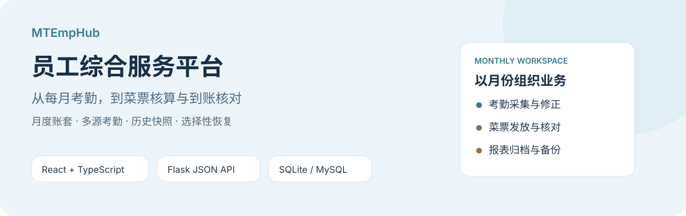
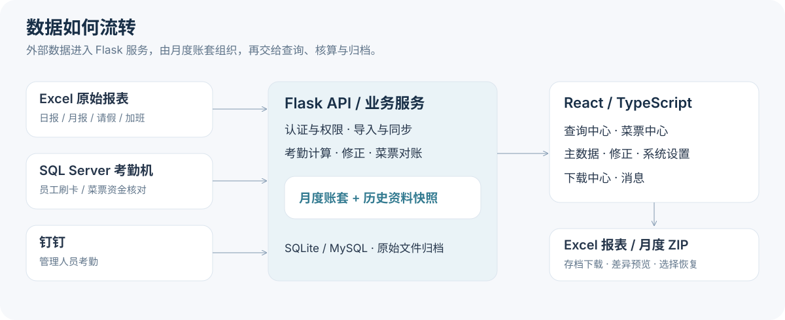
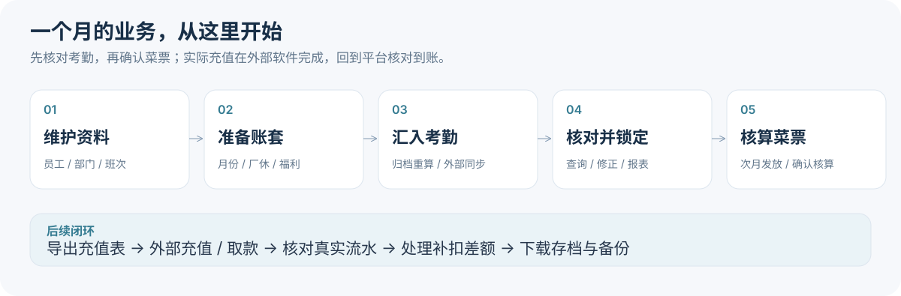

<div align="center">

# MTEmpHub

**以月度账套为中心的员工考勤与菜票管理平台**

[快速开始](#快速开始) · [业务流程](#业务流程) · [配置说明](#配置说明) · [部署与运维](#部署与运维) · [使用指南](#使用指南)



React 18 · TypeScript · Vite 8 · Flask 3 · SQLAlchemy · SQLite / MySQL

[](LICENSE)

</div>

MTEmpHub 将 Excel 报表、考勤机数据库和钉钉考勤汇入月度账套，供管理员完成数据核对、考勤修正、菜票核算、实际资金核对与报表归档；查询账号按授权范围查看个人或部门数据。

平台中的“确认核算”“已完成操作”和“实际到账”各有独立含义。平台可读取外部数据库核对资金，充值和取款仍须在外部菜票软件或设备中办理。

## 功能概览

| 模块 | 主要能力 |
| --- | --- |
| 🔎 查询中心 | 个人考勤日历、员工与管理人员月度考勤、异常、原始打卡、部门工时、加班、年休及独立菜票查询 |
| 📅 账套中心 | 按月建账、厂休与福利设置、原始报表归档、重新计算、进度查询、锁定与解锁 |
| 🍽️ 菜票中心 | 次月核算、额外补扣、本月不发、确认核算、充值表导出、实际流水核对、后续逐人办理及全部资金核对 |
| 🧾 菜票台账 | 客人卡管理与充值匹配、外来人员充卡和纸质领用、部门发放汇总、全年汇总、月末取款与清零 |
| 🗂️ 主数据与修正 | 员工、部门层级、班次与分配；离职复职、每日/月度考勤修正、请假处理、迟到冲抵 |
| 📥 下载中心 | 考勤汇总，以及充值记录、部门发放、外来领用、全年汇总、月末取款等 Excel 存档 |
| ⚙️ 系统管理 | 管理员与查询账号、页面和数据授权、站内富文本消息、来源同步、菜票规则、月度快照管理 |
| 📦 备份恢复 | 多月份 ZIP 导出、差异预览、选择性恢复、依赖校验，兼容旧单月备份 |

## 系统架构



- **前端**：React、TypeScript、React Router 和 Vite，通过 `/api/` 访问后端；Vitest 与 Testing Library 提供测试。
- **后端**：Flask 应用工厂与 JSON API，SQLAlchemy 管理模型，Flask-Migrate / Alembic 管理数据库版本。
- **数据存储**：应用数据库默认使用 SQLite，也支持 MySQL；上传文件独立保存在文件系统。
- **外部来源**：通过 `pymssql` 读取 SQL Server 考勤机数据，通过钉钉 API 同步管理人员考勤。外部 SQL Server 与应用数据库分别配置。

<details>
<summary>查看项目目录</summary>

```text
MTEmpHub/
├── app.py                     # 应用工厂、日志与 /health
├── manage.py                  # 数据库、管理员及迁移 CLI
├── wsgi.py                    # 生产 WSGI 入口
├── config.py                  # 后端环境配置与校验
├── models/                    # 业务 ORM 模型
├── routes/                    # 认证、查询、后台、菜票与备份 API
├── services/                  # 导入、计算、同步、核对与恢复服务
├── utils/                     # Excel 解析、导航和公共工具
├── migrations/                # Alembic 数据库迁移
├── frontend/
│   ├── src/api/               # API 客户端
│   ├── src/pages/             # 查询、后台、菜票与下载页面
│   ├── src/components/        # 公共组件
│   ├── src/router/            # 页面路由与访问保护
│   └── vite.config.ts         # 开发代理与测试配置
├── templates/export_templates/ # Excel 导出模板
├── tests/                     # 后端回归测试及备份兼容样例
├── scripts/                   # Windows / Ubuntu 部署及诊断工具
└── docs/                      # 使用指南、设计与专项验收记录
```

运行数据主要位于 `instance/`、`static/uploads/` 和 `logs/`。默认数据库为 `instance/attendance.db`，账套原始文件位于 `static/uploads/account_sets/<YYYY-MM>/`。

</details>

## 快速开始

### 1. 准备环境

建议使用 Python 3.12、Node.js 24 和 npm；默认 SQLite 无需单独安装数据库服务。当前前端锁定依赖不支持 Node 18，使用 Node 22 时建议至少 22.13。

在项目根目录执行（已有 `.env` 时保留原配置）：

```bash
python3 -m venv .venv
source .venv/bin/activate
python -m pip install -r requirements.txt
cp .env.example .env
```

Windows PowerShell 对应命令：

```powershell
python -m venv .venv
.\.venv\Scripts\Activate.ps1
python -m pip install -r requirements.txt
Copy-Item .env.example .env
```

LibreOffice 是可选依赖，用于部分旧 `.xls` 和特殊报表的转换兜底。

### 2. 设置密钥与管理员密码

编辑根目录 `.env`，替换示例密钥，并自行添加 `INITIAL_ADMIN_PASSWORD`：

```dotenv
DATABASE_URL=sqlite:///attendance.db
SECRET_KEY=替换为随机密钥
INITIAL_ADMIN_PASSWORD=替换为初始管理员密码
FRONTEND_ORIGINS=http://localhost:5173,http://127.0.0.1:5173
```

可生成随机密钥后复制到配置中：

```bash
python -c "import secrets; print(secrets.token_hex(32))"
```

`.env.example` 自带的密钥占位符会被启动校验拒绝。系统没有内置管理员默认密码。

### 3. 初始化数据库

```bash
python -m flask --app manage.py init-db
python -m flask --app manage.py init-admin
```

初始账号为 `admin`，密码为上一步配置的值。`init-admin` 仅创建不存在的账号，不会重置已有密码。普通应用启动不会自动建表或创建管理员。

### 4. 启动服务

后端终端（根目录，已激活虚拟环境）：

```bash
python app.py
```

另开终端启动前端：

```bash
cd frontend
npm ci
npm run dev
```

访问 [本地前端](http://localhost:5173)，使用 `admin` 登录。后端默认端口为 `5000`，前端开发端口为 `5173`，Vite 将 `/api/` 代理至后端。

```bash
curl http://127.0.0.1:5000/health
# {"status":"ok"}
```

健康检查仅确认 HTTP 服务响应，不检查数据库和外部来源连接。

完成配置与初始化后，Mac / Linux 可用 `VENV_DIR=.venv bash macrun2.sh` 同时启动前后端。脚本会安装依赖并开启调试，不负责数据库初始化，仅用于开发。

## 业务流程



### 考勤：先归档或同步，再核对计算结果

1. **维护基础资料**：核对员工工号、部门、人员类型、班次及统计来源。
2. **创建月度账套**：选择 `YYYY-MM`，配置厂休和福利天数。
3. **汇入考勤**：本地报表先上传归档，再执行对应人员类型的“重新计算”；外部来源配置连接后按月同步。
4. **核对结果**：处理异常、日/月修正、请假及迟到冲抵，检查加班、年休与部门工时。
5. **锁定账套**：确认后导出报表；修改、同步、重算或恢复前须先解锁相应月份。

**上传原始报表只完成归档，不代表考勤数据已经入库。** 同一账套同一类型再次上传会替换原归档槽位。

<details>
<summary>原始报表的识别规则与外部来源</summary>

原始报表支持 `.xlsx` / `.xls`，按文件名从上到下识别：

| 文件名特征 | 识别类型 |
| --- | --- |
| 包含“加班” | 加班单 |
| 包含“请假” | 请假单 |
| 包含“管理人员”和“月报” | 管理人员月报 |
| 包含“管理人员” | 管理人员日报 |
| 包含“月报” | 员工月报 |
| 其余 | 员工日报 |

日报和月报文件名须含可识别年月，如 `2026_8月员工基础数据(日报).xls`，且与账套月份一致。请假单和加班单不要求文件名带月份。内容须满足解析器表头要求；基础资料、修正和年度统计导入应使用各页面专用模板。

- **员工考勤机**：在“系统设置 → 数据来源与同步”配置 SQL Server 并选择 `card_db`。客户端适配 `KQ_BrushCard`、`ST_Person`、`ST_Department`，优先按工号匹配，再尝试卡号。重算时先同步并跳过本地员工日报，月报、请假、加班仍参与处理。
- **管理人员钉钉**：配置三项服务端凭证及应用考勤/通讯录读取权限，切换来源为 `dingtalk` 后按月同步。按工号匹配本地人员，未匹配项可下载 CSV 核对；钉钉来源下重算跳过本地管理人员日报和月报。
- **统计口径**：实际打卡天数与出勤天数不同。每日“实际打卡”人工标记优先；工时、请假、厂休、福利、加班及修正按各自业务规则计算。

</details>

### 菜票：核算、外部办理与到账核对

菜票按**计划充值月份**组织，例如 9 月充值使用 8 月考勤。月度基础金额以实际打卡口径乘以 8 元计算，并结合异常扣除规则、补扣及“本月不发”等设置。

1. 在“月度发放”生成草稿，核对人员、金额与异常；源考勤变化后可重算草稿。
2. 锁定对应考勤账套后确认核算，再导出专用 `.xls` 充值表。文件仅含工号和充值金额两列、无表头，工号保留前导零。
3. 在外部菜票软件完成充值，再回平台核对数据库到账，或在未启用数据库核对时凭真实凭证登记。
4. 确认后的补发、扣除和考勤差额在“后续补扣与对账”处理。按任务逐人办理，操作声明保存进度，真实流水核对后才改变实际发放账目。
5. 用“核对全部资金”检查指定日期范围内员工、客人卡及取款流水的归属；员工账目结清与全部资金核清分别判断。

下载充值表不会登记到账。确认后的基础金额保留快照；已发生发放、外部操作声明或后续重算等业务后，不能随意退回草稿。已确认月份沿用当时的异常扣除规则。

外来人员支持充卡、纸质领用和客人卡绑定；绑定卡的领用可匹配数据库实际充值，避免同笔资金重复归属。部门发放汇总由实际发放和有效外来领用数据生成。月末取款需区分业务扣回与清零，清零不直接核销补扣任务。

完整步骤、部分到账、抵消规则、旧月接入和更正方式见 [菜票中心使用指南](docs/meal-ticket-workflow-user-guide.md)。

### 历史资料与备份恢复

月度快照保存员工、部门和班次等历史资料，当前转部门、离职或班次变化不会自动刷新过去月份。管理员可在“系统设置 → 快照管理”查看、补齐或重建；补齐只新增缺失项，重建会用当前资料替换所选月旧快照。旧月基线只能保证采集后稳定，不能证明当时的真实资料。

在账套设置中可导出多月份 ZIP，导入时经过“选择备份 → 核对差异 → 确认恢复”。支持按月份、类别及条目选择，冲突和依赖须在预览中明确处理。

- 备份可包含当前基础资料、历史快照、考勤、菜票、独立台账、原始文件、账号密码哈希与授权等内容；不包含 `.env`、数据库连接凭证、JWT 密钥和站内消息。
- 兼容旧单月 v1 与多月 v2。旧包未包含的数据范围视为 **absent（未包含）**，不按空表删除目标记录；缺失删除仅限明确包含、完整且已选择的范围。
- 恢复只还原本地业务记录，不调用外部充值或扣款设备。目标数据变化后须重新比较，锁定的影响月份须先解锁。
- 月度 ZIP 用于业务交换与选择恢复；整站恢复仍需数据库、上传文件与配置的配套备份。

详见 [多月份备份与选择性恢复指南](docs/monthly-backup-user-guide.md)。

## 配置说明

后端在启动时加载根目录 `.env`。初始密码等未列入示例文件的参数需自行添加。

| 参数 | 默认值 / 用途 |
| --- | --- |
| `SECRET_KEY` | 必填；签名密钥，缺失或使用已知占位符时拒绝启动 |
| `INITIAL_ADMIN_PASSWORD` | 首次创建 `admin` 时必填 |
| `DATABASE_URL` | `sqlite:///attendance.db`；MySQL 使用 `mysql+pymysql://用户:密码@主机:3306/库名` |
| `APP_ENV` | `development`；生产部署设为 `production` |
| `FLASK_DEBUG` | `python app.py` 仅显式为 `1` 时开启调试 |
| `JWT_EXPIRES_HOURS` | 普通登录令牌默认有效 12 小时 |
| `FRONTEND_ORIGINS` | 逗号分隔的前端来源白名单，用于 CORS 和写请求来源校验 |
| `FRONTEND_ORIGIN` | 未配置多来源时使用，默认 `http://localhost:5173` |
| `FRONTEND_APP_URL` | 前端地址，默认取来源白名单首项 |
| `SESSION_COOKIE_NAME` | 默认 `access_token` |
| `SESSION_COOKIE_SAMESITE` | 默认 `Lax` |
| `SESSION_COOKIE_SECURE` | 默认 `false`；HTTPS 部署设为 `true` |
| `SETUP_PASSWORD` | 数据库向导独立访问密码，接口读取根目录 `.env` 中的值 |
| `DINGTALK_CLIENT_ID` / `DINGTALK_CLIENT_SECRET` / `DINGTALK_CORP_ID` | 启用钉钉同步时配置 |
| `UPLOAD_FOLDER` | 默认项目内 `static/uploads` |
| `CALC_PROGRESS_DIR` | 默认 `instance/calc_progress` |
| `LOG_DIR` | 默认 `logs`，未处理异常写入轮转的 `error.log` |

前端变量配置在 `frontend/` 对应环境文件中：

| 参数 | 用途 |
| --- | --- |
| `VITE_BACKEND_TARGET` | 开发和预览代理目标，默认 `http://127.0.0.1:5000` |
| `VITE_API_BASE_URL` | 浏览器 API 基础地址，默认空值，使用同源路径 |

生产前端变量变化后需重新构建。`VITE_*` 会用于客户端，不能存放数据库密码或钉钉密钥。

### 账号与权限

管理员可访问后台和全部查询页；查询账号同时受**页面权限**与**员工/部门授权范围**约束。开通页面不代表可查看全公司数据。公司级菜票台账另受 `meal_ledger_query` 权限控制，仅有菜票查询权限时仍按授权人员范围访问。

认证使用 JWT Cookie，后端也校验数据权限。写请求检查 Origin/Referer，白名单须包含实际访问的协议、主机和端口。离职处理会联动相关账号停用，复职可解除相应锁定。

## 数据库升级与切换

升级前备份数据库、配置和归档文件。新空库使用 `init-db`：最早迁移假定表已存在，不能用直接 `db upgrade` 代替首次初始化。

```bash
# 查看当前迁移版本
python -m flask --app manage.py db current

# 执行增量升级
python -m flask --app manage.py db upgrade

# 按历史库实际情况补齐兼容结构
python -m flask --app manage.py upgrade-legacy-schema
```

旧库若长期停在基线版本，但已通过兼容补丁建过后续表，直接升级可能遇到重复表或列。先核对实际结构和迁移版本，不应盲目修改版本号；兼容补丁也不能代替所有增量迁移。

数据库向导位于 `/database-setup`，配置 `SETUP_PASSWORD` 后可独立解锁，提供连接测试、SQLite / MySQL 迁移及切换。**迁移和切换是两个步骤，切换后需重启后端。**

当前 [迁移服务](services/migration_service.py) 使用固定表清单，未覆盖 `messages`、`daily_attendance_overrides`、`account_set_backup_origins`、`account_set_backup_restores`。切库前须核对遗漏数据及上传文件。MySQL → SQLite 向导写入根目录 `attendance.db`，而默认应用连接使用 `instance/attendance.db`，切换前须核实实际文件路径。

`python switch_sqlite.py` 可交互修改连接并备份 `.env`；它不复制 MySQL 最新数据，须先确认本地 SQLite 数据可用。

## 部署与运维

生产部署使用 Web 服务器托管 `frontend/dist`，配置 SPA 回退到 `index.html`，并将 `/api/` 代理至 WSGI 服务。设置实际 `FRONTEND_ORIGINS`，HTTPS 下启用安全 Cookie，关闭调试。

### Linux / Ubuntu

完成配置与数据库初始化后，在后端虚拟环境安装 Gunicorn：

```bash
python -m pip install gunicorn
python -m gunicorn -w 4 -b 127.0.0.1:5000 --timeout 600 wsgi:app
```

前端构建：

```bash
cd frontend
npm ci
npm run build
```

可参考 [Systemd 服务](scripts/ubuntu/attendance_api.service) 与 [Nginx 配置](scripts/ubuntu/attendance_nginx)。示例固定使用 `/var/www/mtemphub`、用户 `mt` 和服务名 `attendance_api`，部署前须调整；独立服务文件还需补充适合长请求的 `--timeout`。Nginx 已配置 600 秒读取超时，上传限制须覆盖 ZIP 大小与 multipart 开销。

`deploy_15.sh` 仍包含 Node 18 安装逻辑，`update.sh` / `restart.sh` 依赖固定部署环境，使用前应阅读并调整。现有 Nginx 示例仅代理 `/api/`，健康检查可直接请求后端 `/health`。

### Windows

准备 `.env` 后可用 PowerShell 执行后端部署脚本：

```powershell
.\deploy_production.ps1 -ProjectRoot "D:\MTEmpHub"
```

该入口创建生产虚拟环境、初始化数据库和管理员。安装 NSSM 服务时使用：

```powershell
.\deploy_production.ps1 -ProjectRoot "D:\MTEmpHub" -InstallService -NssmPath "C:\nssm\nssm.exe"
```

前端仍需单独构建并托管。也可在已激活的后端虚拟环境中直接运行 Waitress：

```powershell
python -m waitress --host=0.0.0.0 --port=5000 wsgi:app
```

Git Bash 下的 `winrun.sh` 提供 Waitress + Vite preview，默认端口为后端 `5001`、前端 `4173`，需将实际前端来源加入白名单。

### 整站备份

整站备份至少保留数据库、上传目录和 `.env`，并确保来自一致时间点。Windows 提供 [备份脚本](scripts/windows/backup_state.ps1) 与 [回滚脚本](scripts/windows/rollback_state.ps1)，默认覆盖 `.env`、`instance/attendance.db` 和 `static/uploads`；自定义路径时须调整，MySQL 使用数据库自身备份工具。

## 开发验证

后端测试所需 pytest 未包含在生产依赖中：

```bash
python -m pip install pytest
python -m pytest tests -q
```

前端测试与构建：

```bash
cd frontend
npm ci
npm test
npm run build
```

测试覆盖认证与权限、CSRF、考勤统计与修正、文件导入、外部同步、菜票核算和资金核对、数据库升级及备份恢复。专项 MySQL、规模及浏览器验收记录位于 `docs/testing/` 和相关设计文档中，应结合记录中的验证边界评估目标环境。

修改业务 ORM 表、字段或关系时，须同步备份映射、导出、预览、恢复、依赖校验、版本迁移和旧格式测试，并随既有测试运行：

```bash
python -m pytest tests/test_backup_coverage.py -q
```

## 常见问题

| 现象 | 排查方向 |
| --- | --- |
| 启动提示密钥无效 | 替换 `.env` 中 `SECRET_KEY` 的示例值 |
| 无法创建管理员 | 添加 `INITIAL_ADMIN_PASSWORD`；命令不会重置已有密码 |
| 缺表或字段 | 区分新库初始化、旧库兼容补丁和 Alembic 增量迁移 |
| 登录或保存提示跨站校验失败 | 检查实际浏览器来源是否在 `FRONTEND_ORIGINS` 中 |
| 上传后查询没变化 | 上传只归档，继续执行对应账套重新计算 |
| 导入、重算或同步被拒绝 | 检查账套锁定状态及报表文件名年月 |
| 同步有未匹配人员 | 核对工号、卡号、钉钉用户及人员统计来源，下载未匹配报告 |
| 菜票操作后仍待核对 | 操作声明不等于到账，继续核对真实资金流水 |
| 上传 413 / 长请求 504 | 同时检查代理上传限制、应用与代理超时 |
| 刷新子页面 404 | 检查静态服务器 SPA 回退配置 |
| 后端 500 | 查看 `logs/error.log` 和系统服务日志 |

## 使用指南

- [菜票中心使用指南](docs/meal-ticket-workflow-user-guide.md)：月度发放、逐人补扣、全部资金核对、取款与旧月接入。
- [多月份备份与选择性恢复](docs/monthly-backup-user-guide.md)：导出、差异选择、历史快照、依赖与恢复结果。
- [备份验证记录](docs/testing/monthly-backup-verification.md)：验证命令、结果与未覆盖边界。
- [菜票流程交接记录](docs/design/2026-10-10-meal-ticket-workflow-handoff.md)：已验证范围和后续验收事项。
- [备份设计](docs/design/2026-10-09-monthly-backup-design.md)：数据范围与 Schema 同步约束。

## 开源协议

本项目采用 [MIT License](LICENSE)。
